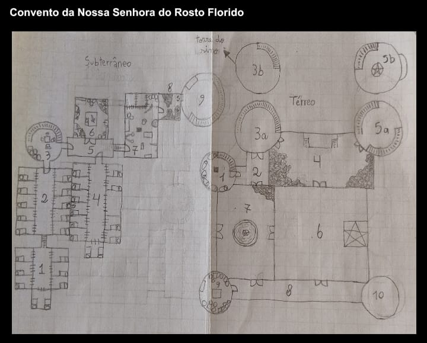

# Salazar — RPG de Texto

Um RPG de texto em Python ambientado num mundo de fantasia medieval com as regras de **D&D 5ª edição**.
Você controla **Salazar**, um herói totalmente personalizável: escolha o nome, a raça, a classe, os atributos e o alinhamento.

## Como jogar

Precisa do [Python 3.9+](https://www.python.org/downloads/).

```bash
git clone https://github.com/Henrique-Inf/Salazar-RPG-TextGame.git
cd Salazar-RPG-TextGame
pip install -r requirements.txt
python main.py
```

Os menus são navegados com **↑ ↓** e **Enter** (biblioteca [questionary](https://github.com/tmbo/questionary)).
Sem ela, ou fora de um terminal de verdade, o jogo usa listas numeradas e continua funcionando.

## O que já existe

- Criação de personagem completa
  - 9 raças: Anão, Elfo, Halfling, Humano, Draconato, Gnomo, Meio-Elfo, Meio-Orc e Tiefling
  - 12 classes: Bárbaro, Bardo, Bruxo, Clérigo, Druida, Feiticeiro, Guerreiro, Ladino, Mago, Monge, Paladino e Patrulheiro
  - 3 formas de definir atributos: conjunto padrão, rolagem 4d6 e compra de pontos
  - Alinhamento
- Ficha calculada automaticamente: PV, CA, iniciativa, modificadores e salvaguardas
- Salvar e carregar o jogo (arquivos em `saves/`), incluindo onde você está
- Exploração do **Convento da Nossa Senhora do Rosto Florido**: 22 salas em dois andares (subterrâneo e térreo) e a saída para o exterior
- Itens e inventário: pegar coisas do chão, usar itens em certos lugares e resolver o primeiro quebra-cabeça do jogo (como sair do convento?)

## Como explorar

A tela é limpa a cada passo: no topo fica o seu personagem (nome, raça, classe e PV), depois a descrição da sala, o resultado da última ação e o menu. Você escolhe uma ação:

- **Ir para o norte / sul / leste / oeste…**: as saídas da sala (e as escadas, com *Subir* e *Descer*). Salas que você já visitou mostram o nome ao lado.
- **Examinar…**: abre uma lista com as coisas da sala que dá para olhar de perto
- **Pegar…**: aparece quando há algo para pegar na sala
- **Usar item…**: escolha um item do inventário para usar naquele lugar
- **Inventário**: o que você está carregando; escolha um item para ver a descrição
- **Mapa**: lugares que você já visitou
- **Ficha do personagem**
- **Salvar jogo** / **Salvar e voltar ao menu**

## Sala de testes

No menu inicial há a opção **Sala de testes**: um lugar à parte para experimentar as novidades antes de elas entrarem no jogo de verdade. Nada ali é salvo, e os seus jogos salvos nunca são tocados.

Você escolhe uma raça e uma classe e recebe um personagem pronto, numa sala branca com todos os itens do jogo espalhados pelo chão. O menu **Ferramentas de teste…** permite:

- **Dar item…**: pegar qualquer item do jogo, ou todos de uma vez
- **Esvaziar inventário** e **Curar totalmente**
- **Mudar nível…**: do 1 ao 20
- **Eventos…**: ligar e desligar os eventos do jogo (por exemplo, "a gaveta está aberta"), para testar qualquer parte de um quebra-cabeça sem refazer o caminho
- **Ir para…**: ir direto para qualquer sala do convento, mantendo o modo de teste
- **Reiniciar tudo**

Para testar uma novidade nova (um combate, um personagem para conversar...), escreva uma função em `salazar/ferramentas_teste.py` e acrescente-a ao dicionário `FERRAMENTAS`: ela aparece sozinha no menu. A sala de testes usa o mesmo formato das salas do convento, então o que funciona lá funciona no jogo.

## O mapa



Os textos de todas as salas ficam em `salazar/mundo.py`: para mudar uma descrição, é só editar lá.
Depois de mexer no mapa ou nos itens, rode `python -m unittest`. Os testes conferem se toda saída tem volta, se todas as salas são alcançáveis, se todo item existe e se o jogo ainda pode ser zerado.

### Como criar um item

1. Em `salazar/itens.py`, acrescente o item com nome e descrição.
2. Em `salazar/mundo.py`, ponha o id dele em `"itens"` na sala onde ele fica. Use `{"id": ..., "flag": ...}` se ele só aparece depois de um evento.
3. Se ele deve fazer algo, descreva em `"usos"` da sala o que acontece ao usá-lo ali. A `"flag"` guarda que o evento já aconteceu, e `"saidas_condicionais"` pode liberar uma passagem por causa dela.

Os textos e as regras de cada sala ficam todos em `mundo.py`, explicados no comentário do topo do arquivo.

## Próximos passos

- [x] Exploração: locais, movimento e descrições
- [ ] Combate por turnos com rolagens de ataque e dano
- [x] Inventário e itens
- [ ] Experiência e subida de nível
- [ ] Missões, diálogos e escolhas

## Estrutura

```
main.py                 # menu principal
requirements.txt        # dependências (questionary)
salazar/
  mundo.py              # o convento: salas, saídas, itens e o que cada item faz
  itens.py              # nome e descrição de cada item
  laboratorio.py        # a sala de testes (usa o mesmo formato das salas do convento)
  ferramentas_teste.py  # menu de ferramentas e personagem da sala de testes
  inventario.py         # pegar, usar e examinar itens
  exploracao.py         # menu de exploração e prólogo
  dados.py              # raças, classes e tabelas de regras
  dados_rolagem.py      # rolagem de dados
  personagem.py         # ficha do personagem, cálculos, salvar/carregar
  criacao.py            # criação de personagem passo a passo
  interface.py          # menus navegáveis (setas) e entradas no terminal
tests/                  # testes automáticos (python -m unittest)
docs/                   # planta do convento
```

## Licença das regras

Este jogo usa conteúdo do System Reference Document 5.1 ("SRD 5.1") da Wizards of the Coast LLC,
disponível em https://dnd.wizards.com/resources/systems-reference-document e licenciado sob a
Creative Commons Attribution 4.0 International License (https://creativecommons.org/licenses/by/4.0/legalcode).
